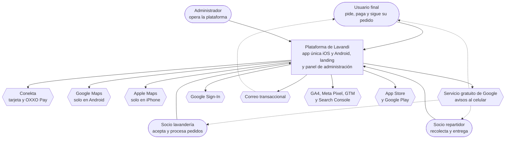

# C1 — Diagrama de contexto

Quién usa el sistema y con qué depende de terceros. Formato Mermaid, por `ADR-0001`.

**Regla YAGNI.** Cada caja de aquí tiene su cita. Ninguna existe "porque toda app la lleva".

## Convención de este diagrama y de los siguientes

| Forma | Significa |
|---|---|
| `[texto]` rectángulo | El sistema que construimos |
| `([texto])` redondeado | Persona |
| `[(texto)]` cilindro | Almacén de datos |
| `{{texto}}` hexágono | Sistema externo de terceros |

Los identificadores de contenedor (`app-movil`, `api`, `bd`) se escriben **igual en C2 y C3**. Es la
mitigación que exige `ADR-0001`: Mermaid no tiene modelo único, así que la consistencia se sostiene a
mano y se revisa al cerrar la fase. **En C1 no aparecen**, y es correcto: en este nivel la plataforma
es una sola caja. Los identificadores de C1 son los de los actores y los sistemas externos.

## Diagrama

Línea punteada: el sistema externo alcanza a la persona sin pasar por nuestra interfaz.

## Los cuatro actores

| Actor | Qué hace | Cita (A) |
|---|---|---|
| Usuario final | Elige lavandería, agenda recolección, paga y sigue su pedido | p. 16-17, A.3 Módulo A |
| Socio lavandería | Acepta o rechaza pedidos con motivo, mueve estados, ve su historial | p. 17, A.3 Módulo B |
| Socio repartidor | Acepta pedidos asignados, recolecta, transporta y entrega | p. 18, A.3 Módulo C |
| Administrador | Da de alta y suspende, monitorea, configura comisiones, ve reportes | p. 19, A.3 Módulo D |

**El repartidor no se da de alta solo.** *"El alta, validación y autorización del repartidor
corresponden a EL CLIENTE"* (p. 18). El Módulo C **registra**; no valida identidad ni documentos.

## Sistemas externos, cada uno con su renglón del ANEXO B

El método lo pide así para que **cada costo tenga dueño**. Todos los servicios se contratan y se
pagan a nombre de EL CLIENTE (RN-20, B.11); EL PRESTADOR solo tiene accesos de colaborador
revocables.

| Sistema externo | Para qué | Renglón del ANEXO B | Quién paga | Riesgo de costo |
|---|---|---|---|---|
| **Conekta** | Cobro con tarjeta y OXXO Pay, en producción | B.6 (cuenta bancaria empresarial) y B.10 (alta, 1 a 3 semanas, **semana 4**) | EL CLIENTE | Comisión por transacción. Quién la absorbe: **DD-013, abierta** |
| **Google Maps** | Mapa en Android | B.5 | EL CLIENTE | **El más alto.** B.5 documenta que Google retiró el crédito gratuito y que cada pedido dispara varias consultas. Ver R-006 y el presupuesto de consultas |
| **Apple Maps** | Mapa en iPhone | B.5 | EL CLIENTE | Sin costo por uso hoy. Obliga a un SDK distinto por plataforma (RN-29) |
| **Servicio gratuito de Google para avisos** | Notificaciones push en ambos sistemas | B.5; A.3 p. 19 | EL CLIENTE | Sin costo. En iPhone se apoya en el servicio de Apple, que exige la cuenta de desarrollador |
| **Google Sign-In** | Registro y acceso con cuenta de Google | A.3 numeral 2 | — | Sin costo. Sin renglón propio en el ANEXO B |
| **Correo transaccional** | Confirmación del pedido con folio | B.5, "correos automáticos" | EL CLIENTE | Bajo con volumen inicial. Es el respaldo cuando el usuario niega permiso de notificaciones |
| **GA4, Meta Pixel, GTM, Search Console** | Medición de la landing | B.11 (cuentas a nombre del cliente) | EL CLIENTE | Sin costo |
| **App Store y Google Play** | Publicación | B.2 y B.10 (D-U-N-S hasta 30 días; Apple 1 a 2 semanas) | EL CLIENTE | Cuotas anuales de desarrollador. **Bloquea la publicación si no arranca en semana 1** |

## Lo que NO aparece, y por qué

| Lo que alguien esperaría | Por qué no está |
|---|---|
| Verificación de identidad o antecedentes del repartidor | Excluido por contrato (p. 18, Módulo C). `NO JUSTIFICADO` |
| Servicio de SMS para verificar el teléfono | *"No forma parte del alcance base"* (p. 30, B.5). `NO JUSTIFICADO` |
| Motor de asignación automática u optimización de rutas | Excluido (RN-12). `NO JUSTIFICADO` |
| Dispersión automática de pagos a socios | Excluido (RN-12). El sistema **informa** cuánto toca; no mueve dinero (BR-28) |
| Rastreo GPS continuo del repartidor | Excluido fuera de un pedido activo (RN-12), y dentro de uno no está exigido. Queda fuera de la v1 |

Esta tabla es tan importante como el diagrama: **la arquitectura no los implementa, pero tampoco debe
imposibilitarlos**, porque la Cláusula X prevé incorporarlos por Orden de Cambio. Cómo se deja la
puerta abierta sin construir la puerta es BR-36, y se resuelve en C2 y C3.

## Lo que este nivel deja pendiente

`ESPECIFICACIÓN PENDIENTE` — el recorrido del pedido entre los cuatro actores depende de quién
asigna repartidor (DD-014) y de si la lavandería puede repartir con su propia gente (DD-022). El C1
muestra que los cuatro hablan con el sistema; **no** afirma en qué orden.
