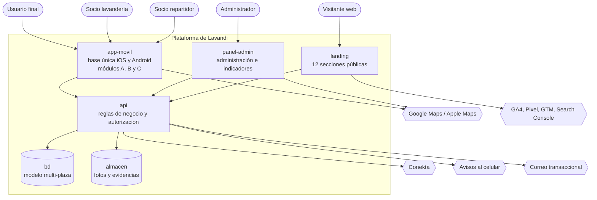

# C2 — Diagrama de contenedores

Qué piezas desplegables existen, qué hace cada una **en una frase**, y qué obligación la justifica.

**Ningún contenedor de aquí implica una tecnología.** El stack se decide en la Fase 6. Decir "base de
datos" no es decir cuál.

## Diagrama

## Responsabilidad y justificación

| Id | Responsabilidad, en una frase | Qué lo justifica |
|---|---|---|
| `app-movil` | Atiende a los tres tipos de socio y usuario desde una sola base de código que se comporta igual en iPhone y Android | **A**: O-12, RN-01, RN-02 (p. 16, A.3) |
| `panel-admin` | Da de alta y suspende cuentas, monitorea pedidos en tiempo real y muestra los indicadores del negocio | **A**: O-16 (p. 19, Módulo D) y O-21 (p. 22, A.5) |
| `landing` | Presenta el servicio al público en 12 secciones y capta lavanderías interesadas | **A**: O-07 a O-11 (pp. 15-16, A.2) |
| `api` | Concentra las reglas del pedido, el dinero y quién puede ver qué | **A**: RN-09 aislamiento entre socios; RN-05 los 60 s. Un cliente móvil no puede ser el guardián de esas reglas |
| `bd` | Guarda plazas, socios, usuarios, pedidos y movimientos, con la plaza como dimensión de primera clase | **A**: O-26, RN-03 (p. 4, Cláusula I). Ver `modelo-multi-plaza.md` |
| `almacen` | Guarda las fotos de las lavanderías, las de perfil y las evidencias de recolección y entrega | **A**: p. 20, "Guarda las fotografías de las lavanderías, las fotos de perfil y las evidencias de entrega", y B.4, que presupuesta almacenamiento. Ver BR-29. Corregido el 2026-09-25 por `contrato/inventario-funcional.md`: antes solo nombraba las evidencias |

**El panel de indicadores no es un contenedor.** O-21 dice literalmente *"integrado en
administración"*. Dibujarlo aparte sería inventar una pieza que el contrato no pide.

## Decisión abierta que este nivel destapa

**¿Dónde vive el Módulo D?**

El contrato lo mete en la misma frase que los otros tres: *"Los cuatro módulos (usuario, socio
lavandería, socio repartidor y administración) accesibles y funcionales conforme a A.3"*
(A.4.3 criterio 3). Pero lo que le exige encaja mal en un teléfono:

- Reportes exportables en **CSV y Excel** para cualquier rango de fechas (RN-13).
- **Mapa de calor** de pedidos por colonia (O-21).
- Monitoreo de pedidos activos **en tiempo real con mapa** (O-16).
- Once indicadores simultáneos (A.5).

El contrato **no dice** si administración es una pantalla más de la app o una aplicación web aparte.
Es una decisión de arquitectura, no una obligación, y cambia el alcance de la Fase 6.

Este C2 lo dibuja como contenedor separado, por dos razones que se sostienen solas: exportar un Excel
desde un teléfono es hostil, y el administrador es el único actor que no está en la calle. **Pero es
una recomendación de Claude, no una decisión tomada.** Queda como **DD-040**, decide Nadir.

Si se decidiera que va dentro de la app, `panel-admin` desaparece como contenedor y se vuelve un
módulo de `app-movil`; el resto del diagrama no cambia. Por eso no bloquea.

## Cómo se cumple el límite de 60 segundos

RN-05 exige que un cambio de estado hecho por la lavandería o el repartidor se refleje en la app del
usuario en **≤ 60 s**. Sesenta segundos es mucho tiempo: admite varias soluciones, y el método
advierte **"sin sobreingeniería"**.

`ESPECIFICACIÓN PENDIENTE` — el mecanismo es `ADR-0007` de la Fase 6. Lo que este nivel sí fija es
**dónde** vive la responsabilidad: el cambio de estado entra por `api`, que es el único que puede
autorizarlo, y desde ahí se propaga. Ningún cliente móvil notifica a otro directamente.

## Cómo se respeta el presupuesto del ANEXO B.4

RN-22 fija rangos mensuales: servidor $345–1,382, base de datos $259–864, almacenamiento $86–432,
respaldos $86–259. **Total $1,200–4,100 MXN al mes.**

Ese techo es grado A y condiciona la Fase 6: `bd` y `almacen` son contenedores separados en el
diagrama porque el contrato los presupuesta por separado, no porque tengan que ser servicios
distintos. Un ADR de infraestructura que se salga del rango contradice el contrato.

## Lo que este nivel deja pendiente

| Marcador | Qué falta | Dónde se resuelve |
|---|---|---|
| `ESPECIFICACIÓN PENDIENTE` | Máquina de estados del pedido y qué rol dispara cada transición | C3, tras DD-011, DD-014, DD-016 y DD-022 |
| `ESPECIFICACIÓN PENDIENTE` | Mecanismo de propagación para los 60 s | `ADR-0007`, Fase 6 |
| `ESPECIFICACIÓN PENDIENTE` | Si `panel-admin` es contenedor propio | **DD-040**, decide Nadir |
| `ESPECIFICACIÓN PENDIENTE` | Presupuesto de consultas de mapas por pedido | `presupuesto-de-mapas.md`, esta fase |
