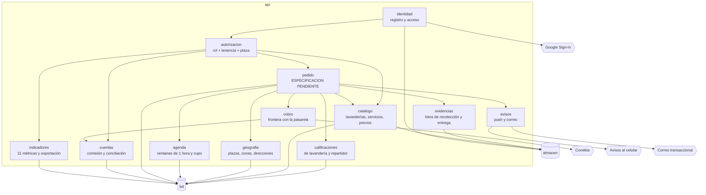

# C3 — Componentes de `api`

El método manda dibujar **un solo** contenedor: *"solo del contenedor más crítico o más incierto.
No dibujes los cuatro"* (`prompt-maestro-01-fundacion-v4.md:258`).

**Se elige `api`**, y es el crítico y el incierto a la vez. Crítico porque es el único lugar donde
pueden vivir el aislamiento entre socios (RN-09) y las reglas del dinero: un cliente móvil no puede
custodiarlas, porque está en el teléfono de la persona a la que hay que restringir. Incierto porque
contiene la máquina de estados, que es lo único de toda la arquitectura que sigue bloqueado.

## Diagrama

## Qué hace cada componente

| Componente | Responsabilidad | Qué lo justifica |
|---|---|---|
| `identidad` | Da de alta y autentica; contraseñas que nadie puede recuperar, ni quien administra | **A**: RN-08, RN-17 (p. 16 y 20) |
| `autorizacion` | Decide si quien pregunta puede ver o tocar **este** dato, por rol, por tenencia y por plaza | **A**: RN-09 (p. 20). Ver abajo |
| `catalogo` | Guarda lavanderías, sus servicios y sus precios por kilo | **A**: A.3 numerales 5 y 6 |
| `geografia` | Resuelve plaza, zona y dirección; decide si un domicilio está dentro de cobertura | **A**: A.2 sección 7; O-26. Ver `modelo-multi-plaza.md` |
| `agenda` | Ofrece ventanas de una hora y lleva el cupo de cada una | **A**: RN-15 (A.3 numeral 7) |
| `pedido` | Gobierna el ciclo de vida del pedido y quién puede moverlo | **A**: A.3 numeral 12; A.4.3. **Bloqueado** |
| `cobro` | Habla con la pasarela. **Nunca guarda un número de tarjeta**. Si se guardan tarjetas para el siguiente pedido, guarda solo la referencia que da la pasarela (BR-50, DD-055) | **A**: RN-10, RN-28 (p. 20 y 16); "métodos de pago" en el perfil (A.3 numeral 15) |
| `cuentas` | Calcula comisión, saldo por socio y concilia contra la pasarela | **A**: Módulo D numerales 5 y 6 (p. 19) |
| `avisos` | Manda los avisos al celular y el correo de confirmación. Si se decide, también el aviso a la lavandería y al repartidor de un pedido nuevo o asignado (BR-49, DD-054) | **A**: RN-06, A.3 numeral 11 |
| `indicadores` | Calcula las once métricas y exporta CSV y Excel | **A**: O-21, O-22, RN-13, RN-14 (p. 22, A.5) |
| `evidencias` | Guarda y sirve las fotos de recolección y entrega. Las fotos de las lavanderías y las de perfil las suben `catalogo` e `identidad` al mismo almacén | **A**: p. 20; B.4. Ver BR-29 |
| `calificaciones` | Guarda la calificación de 1 a 5 con su comentario y calcula los promedios que ven el perfil de la lavandería, los historiales de los socios y el ranking de indicadores. A quién se califica es BR-47 | **A**: A.3 Módulo A numerales 5 y 14, Módulo B numeral 4, Módulo C numeral 4; A.5. Agregado el 2026-09-25 por `contrato/inventario-funcional.md`: nadie tenía a cargo las calificaciones |

## `autorizacion` es el componente que más se puede equivocar

RN-09 no admite matices:

> *"un socio lavandería no puede consultar datos de otro socio ni de usuarios que no le han hecho
> pedidos"* — `NSV-2026-001-v8.pdf:20:ANEXO A, Sección A.3`

Son **tres** dimensiones que se comprueban a la vez, no una:

1. **Rol.** Un repartidor no ve el panel de administración.
2. **Tenencia.** Un socio ve *sus* pedidos, y de los usuarios ve solo a los que le pidieron.
3. **Plaza.** Un socio de Durango no ve datos de La Laguna.

**Decisión de diseño, grado D:** las tres viven en **un solo componente**, no repartidas por los
demás. Una regla de aislamiento escrita en once lugares se contradice en el primer cambio, y la
contradicción no se nota hasta que alguien ve lo que no debía.

O-20 tampoco tiene criterio en A.4, así que se le escribe uno, igual que a O-26:

> **Criterio propuesto (grado D):** existe una prueba automatizada que, para cada tipo de actor,
> intenta leer datos de otro socio, de otro usuario y de otra plaza, y **falla la suite si alguno de
> los tres accesos devuelve datos**. La prueba corre en cada cambio, no una vez.

BR-35 la llama "prueba anti-fuga". Se escribe cuando haya código; su contrato se fija aquí.

## `cobro` — dónde está la frontera

RN-10 dice que los números de tarjeta **nunca** se guardan en la plataforma: los procesa y resguarda
la pasarela. Eso convierte a `cobro` en una frontera, no en un almacén: recibe referencias de la
pasarela, nunca el dato sensible.

`ESPECIFICACIÓN PENDIENTE` — en qué momento se cobra (DD-012) y qué pasa cuando OXXO tarda horas en
confirmar. Es BR-20 y está en el requerimiento al cliente.

## `cuentas` informa, no dispersa

Aquí el contrato se tensa consigo mismo y conviene decirlo: exige conciliación con la pasarela y
manejo de comisiones (Módulo D), y a la vez **excluye** liquidaciones y dispersión automática
(RN-12).

La resolución está en BR-28: **el sistema informa cuánto le toca a cada quien; mover el dinero es
proceso de EL CLIENTE.** Está escrito así en el requerimiento que se le envía, para que no sea una
sorpresa en noviembre.

## `pedido` — lo único bloqueado

`ESPECIFICACIÓN PENDIENTE`. No se dibuja la máquina de estados. R-008 ya advierte que el contrato la
describe de forma inconsistente entre módulos: cinco estados en el Módulo A, cuatro momentos de push
en el mismo módulo, "En proceso de entrega" en el B, "En tránsito" en el C y "cinco momentos" en el
criterio de aceptación.

Dibujarla ahora sería elegir una de esas lecturas y presentarla después como si el cliente la hubiera
pedido. Lo que sí está fijo, y es grado A, son los **cinco estados visibles al usuario**: Confirmado,
Recolectado, En proceso, Listo, Entregado. Sobre eso ya se construyó el componente de seguimiento en
la Fase 4.

Lo libera el requerimiento enviado al cliente: DD-011, DD-014, DD-016 y DD-022.

## Cómo se deja la puerta abierta sin construir la puerta

BR-36 pide que la arquitectura no **imposibilite** lo que hoy está excluido, porque la Cláusula X
prevé incorporarlo por Orden de Cambio. Dos decisiones de diseño, grado D, que cuestan nada hoy:

1. **Los documentos del repartidor son una entidad aparte, no columnas de su perfil.** Si mañana hay
   que guardar una identificación, se agrega una fila, no se rediseña la tabla de personas.
2. **Las evidencias viven en `almacen`, no en la base de datos.** Cambiar su política de retención o
   su cifrado no toca el modelo de datos.

Ninguna de las dos construye la funcionalidad excluida. Solo evitan que agregarla sea un rediseño.
