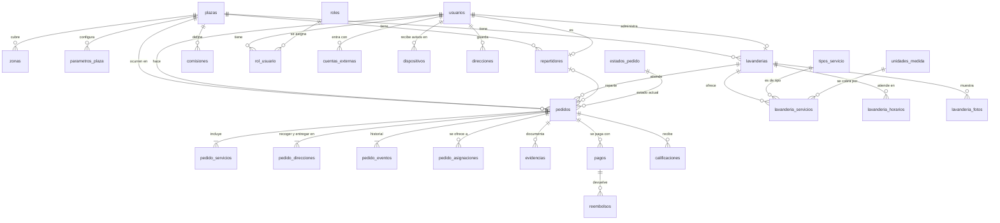

# Modelo de datos

La estructura completa de la base de datos, antes de escribir la primera migración. Arthur la pidió así: "apegarnos al
contrato […] pero la base de datos hay que dejarla con la posibilidad y la escalabilidad: que quede mutable pero bien
definida, normalizada, con una buena estructura y con buenas prácticas" (C-189). La decisión y sus alternativas
están en [[ADR-0016-modelo-de-datos]]. **Es un borrador:** entra a las specs cuando Arthur lo apruebe.

## Lo que pide el contrato

- **Qué guarda la base:** "usuarios registrados, lavanderías, repartidores, pedidos, pagos e historial completo"
  (`NSV-2026-001-v8.pdf:20:ANEXO A, Sección A.3`).
- **Que crezca sin rediseñarse:** la arquitectura debe permitir "su expansión a plazas adicionales de la República
  Mexicana sin necesidad de reescritura del sistema ni de rediseño de la base de datos" (`NSV-2026-001-v8.pdf:4:
  Cláusula I`).
- **Lo que nunca guarda:** "Los números de tarjeta nunca se guardan en la plataforma" (`:20`). Las contraseñas "no se
  guardan en texto legible" (`:20`).
- **Quién ve qué:** "Un socio lavandería no puede consultar los datos de otro socio, ni los de los usuarios que no le
  han hecho pedidos" (`:20`).

## Las reglas del modelo

**Apego al contrato.** Cada tabla existe porque una función del contrato la necesita; la columna "Cita" lo dice. Lo
que el contrato excluye no tiene tabla (la verificación documental del repartidor, `:18`). Lo que todavía no se
decide no se adivina: la tabla nace cuando su fila de la deuda se responde.

**Normalizado (tercera forma normal).**
1. Cada dato vive en un solo lugar. Lo que se repite va en su propia tabla: los servicios de un pedido, sus dos
   direcciones, sus pagos y sus cambios de estado son filas, no columnas numeradas.
2. **Catálogos** para los valores que son datos y pueden crecer: roles, tipos de servicio, unidades de medida y
   estados del pedido. Agregar uno es insertar una fila, no migrar.
3. **Restricciones `CHECK`** para los valores técnicos que solo cambian junto con el código: el estado de un pago, el
   método de pago, la plataforma de un teléfono.
4. **Solo dos excepciones, escritas a propósito:**
   - **La foto del pedido al confirmarse.** El pedido copia el precio y las direcciones del momento en que se
     confirmó. Si la lavandería cambia su precio después, el pedido pagado no cambia. Es historial, no duplicado.
   - **El estado actual en `pedidos`.** Se guarda además del historial de `pedido_eventos`, en la misma transacción,
     para que la lista en tiempo real no recorra el historial cada 30 segundos (ADR-0007).

**Mutable sin rediseño.** Lo que el contrato pide hoy, construido de forma que lo siguiente sea una fila o una tabla
nueva, nunca un cambio de lo existente:

| Si mañana… | Se hace con | Sin tocar |
|---|---|---|
| Se abre otra plaza (`:4:Cláusula I`, por Orden de Cambio) | Filas en `plazas`, `zonas` y `parametros_plaza` | Ninguna tabla |
| Una cuenta necesita dos roles (DD-053) | Otra fila en `rol_usuario` | `usuarios` |
| Entra un servicio nuevo, como el calzado (DD-046, por Orden de Cambio) | Una fila en `tipos_servicio` | `lavanderia_servicios`, `pedido_servicios` |
| Se cobra por pieza el lavado en seco (DD-010) | Una fila en `unidades_medida` | Los precios ya guardados |
| Un pedido lleva varios servicios (DD-098) | Varias filas en `pedido_servicios` | `pedidos` |
| Se cobra una diferencia al pesar (DD-012) | Otra fila en `pagos` con tipo `ajuste` | `pedidos` |
| Cambia la comisión (DD-020) | Una fila nueva en `comisiones` con su fecha de inicio; la anterior queda como historial | Los pedidos ya cobrados |
| Se califica también al repartidor (DD-052) | Filas con `repartidor_id` en `calificaciones` | La tabla |
| Se aprueba la verificación documental del repartidor (`:18`, Orden de Cambio) | Una tabla nueva `documentos_repartidor` | `repartidores` |

**Buenas prácticas.**
- **Llaves.** `id` es un `bigint` generado. Lo que sale por la API se identifica con `public_id`, un ULID: así nadie
  adivina el pedido o la cuenta de otro cambiando un número (`:20`, separación por tipo de usuario).
- **Llaves foráneas en todas las relaciones,** con su índice. `ON DELETE RESTRICT` por omisión: el historial no se
  borra en cascada.
- **La plaza no puede diferir.** Toda tabla de operación lleva `plaza_id` (`modelo-multi-plaza.md`). Cuando la tabla
  es hija de otra que ya la lleva, la llave foránea es compuesta, `(lavanderia_id, plaza_id)` contra
  `lavanderias(id, plaza_id)`: así la base de datos impide un pedido de Durango con una lavandería de La Laguna.
- **Borrado suave** (`deleted_at`) en cuentas, lavanderías, repartidores y direcciones. Pedidos, pagos y eventos no
  se borran nunca: son el "historial completo" (`:20`).
- **Dinero** en `numeric(12,2)` y en pesos; porcentajes en `numeric(5,2)`; cantidades en `numeric(8,2)`. Nunca
  `float`.
- **Horas** en `timestamptz`, como instante absoluto. Se muestran en la zona horaria de la plaza.
- **Mapas** en PostGIS (ADR-0004): puntos y polígonos `geography` con SRID 4326 e índice GiST.
- **Integridad en la base, no solo en el código:** únicos (correo, folio por plaza, `public_id`) y `CHECK` (estrellas
  de 1 a 5, montos y porcentajes en rango, ventana que termina después de empezar).
- **Nombres:** tablas y columnas en español, en `snake_case`, tablas en plural (`CLAUDE.md` §6). Las tablas del
  framework conservan su nombre (`migrations`, `jobs`, `failed_jobs`, `cache`, `sessions`,
  `personal_access_tokens`, `password_reset_tokens`). Como el pluralizador de Laravel es inglés, **cada modelo
  declara su `$table`** (`Direccion` → `direcciones`, no `direccions`).
- **Fotos y evidencias** en S3; en la base, solo la ruta (ADR-0006).
- **Migraciones solo hacia adelante,** una por cambio de OpenSpec. Una columna nueva entra como opcional o con valor
  por omisión, para no romper las filas que ya existen.

## El diagrama

## Las tablas

"Nace en" es el cambio de OpenSpec que crea la tabla con su migración. ⛔ marca una tabla que espera una fila de la
deuda: no se crea hasta que se responda.

### Catálogos

| Tabla | Columnas | Reglas | Cita | Nace en |
|---|---|---|---|---|
| `roles` | `id`, `codigo`, `nombre` | `codigo` único. Semilla: `usuario`, `lavanderia`, `repartidor`, `administracion` | `:20` (separación por tipo de usuario); `:16-19` (cuatro módulos) | `registro-e-inicio-de-sesion` |
| `tipos_servicio` | `id`, `codigo`, `nombre`, `activo` | Semilla: los tres del contrato, `estandar`, `planchado`, `seco` | `:16:A.3 #6` | `perfil-de-lavanderia` |
| `unidades_medida` | `id`, `codigo`, `nombre` | Semilla: `kg`. La pieza entra solo si DD-010 la pide | `:16:A.3 #5` ("precios por kilo") | `perfil-de-lavanderia` |
| `estados_pedido` | `id`, `codigo`, `nombre_usuario`, `orden`, `visible_usuario` | Semilla: los cinco del usuario, Confirmado, Recolectado, En proceso, Listo y Entregado, más los internos que fije el ADR de la máquina de estados (DD-123) | `:17:A.3 #12`; Módulos B #3 y C #3 | `resumen-y-confirmacion` |

### Geografía y plazas

| Tabla | Columnas | Reglas | Cita | Nace en |
|---|---|---|---|---|
| `plazas` | `id`, `nombre`, `zona_horaria`, `activa` | Una plaza nueva es una fila. Abrirla fuera del territorio inicial es Orden de Cambio | `:4:Cláusula I` | `plazas-y-zonas` |
| `zonas` | `id`, `plaza_id`, `nombre`, `poligono` (`geography(MultiPolygon)`), `activa` | Índice GiST. Fuente del polígono: DD-094 | `:4:Cláusula I`; `:15:A.2`, sección 7 | `plazas-y-zonas` |
| `parametros_plaza` | `id`, `plaza_id`, `clave`, `valor` (`jsonb`), `vigente_desde`, `vigente_hasta` | Las reglas comerciales que el contrato deja abiertas y cambian con el tiempo: envío (DD-019, DD-025), anticipación y horizonte de la agenda (DD-099), texto de la cancelación (DD-016). Cada `clave` se valida en el código; único `(plaza_id, clave, vigente_desde)` | `:19:Módulo D`; `modelo-multi-plaza.md` | `plazas-y-zonas` |
| `direcciones` | `id`, `public_id`, `usuario_id`, `plaza_id`, `alias`, `calle`, `numero_exterior`, `numero_interior`, `colonia`, `codigo_postal`, `municipio`, `referencias`, `ubicacion` (`geography(Point)`), `es_favorita`, `deleted_at` | La colonia es obligatoria. La plaza sale de la zona que contiene el punto | `:16:A.3 #8` | `direcciones` |

### Cuentas y acceso

| Tabla | Columnas | Reglas | Cita | Nace en |
|---|---|---|---|---|
| `usuarios` | `id`, `public_id`, `nombre`, `correo`, `password` (opcional si entra con Google o Apple), `telefono`, `foto_ruta`, `estado` (`activo`, `bloqueado`), `bloqueado_en`, `terminos_aceptados_en`, `deleted_at` | Toda cuenta, de cualquier rol. Correo único sin distinguir mayúsculas. La contraseña, con hash. Sin `plaza_id`: la persona no pertenece a una plaza, su dirección sí | `:16:A.3 #2`; `:17:A.3 #15`; `:18:Módulo C #1`; `:19:Módulo D #3`; `:20` | `registro-e-inicio-de-sesion` |
| `rol_usuario` | `usuario_id`, `rol_id` | Llave compuesta. En la v1, una cuenta tiene un rol (DD-053), y lo impone el código, no la tabla | `:20` | `registro-e-inicio-de-sesion` |
| `cuentas_externas` | `id`, `usuario_id`, `proveedor` (`google`, `apple`), `sujeto`, `correo` | Único `(proveedor, sujeto)`. Un proveedor nuevo es otra fila, no otra columna | `:16:A.3 #2`; ADR-0005 | `registro-e-inicio-de-sesion` |
| `dispositivos` | `id`, `usuario_id`, `token_fcm`, `plataforma` (`ios`, `android`), `ultimo_uso_en` | `token_fcm` único | `:19` (avisos); ADR-0008 | `avisos` |
| `actividad_usuarios` | `usuario_id`, `fecha` | Llave compuesta: una fila por persona y día. Alimenta "usuarios activos" (DD-111) | `:46:ANEXO D, Sección D.5`; `:22:A.5` | `indicadores` |

### Lavanderías y repartidores

| Tabla | Columnas | Reglas | Cita | Nace en |
|---|---|---|---|---|
| `lavanderias` | `id`, `public_id`, `plaza_id`, `usuario_id`, `nombre`, `descripcion`, `telefono`, `calle`, `numero`, `colonia`, `codigo_postal`, `ubicacion` (`geography(Point)`), `estado` (`pendiente`, `activa`, `suspendida`, `baja`), `aprobada_en`, `deleted_at` | Único `(id, plaza_id)`, para las llaves compuestas de sus hijas. Índice GiST en `ubicacion` | `:17:Módulo B #1`; `:19:Módulo D #1`; `:16:A.3 #3 y #5` | `perfil-de-lavanderia` (de prueba); `alta-de-lavanderias` (alta real) |
| `lavanderia_servicios` | `id`, `lavanderia_id`, `plaza_id`, `tipo_servicio_id`, `unidad_medida_id`, `precio`, `activo` | Único `(lavanderia_id, tipo_servicio_id)`. `precio >= 0`. Quién fija el precio: DD-010 | `:16:A.3 #5 y #6`; `:17:Módulo B #1` | `perfil-de-lavanderia` |
| `lavanderia_horarios` | `id`, `lavanderia_id`, `plaza_id`, `dia_semana` (1 a 7), `hora_inicio`, `hora_fin` | `hora_fin > hora_inicio`. El cupo por ventana entra como columna cuando DD-099 diga cuánto; los festivos, con DD-078 | `:17:Módulo B #1 y #6` | `perfil-de-lavanderia` (**hueco de hoy:** ninguna spec la creaba) |
| `lavanderia_fotos` | `id`, `lavanderia_id`, `ruta`, `orden` | La foto vive en S3 | `:16:A.3 #5`; `:17:Módulo B #1`; `:20` | `perfil-de-lavanderia` |
| `repartidores` | `id`, `public_id`, `plaza_id`, `usuario_id`, `tipo_vehiculo`, `estado` (`pendiente`, `activo`, `suspendido`, `baja`), `aprobado_en`, `deleted_at` | Nombre, teléfono, correo y foto viven en `usuarios`. Único `(id, plaza_id)`. **No tiene columnas de documentos:** la verificación documental está excluida (`:18`) | `:18:Módulo C #1`; `:19:Módulo D #2` | `repartidor` |

### Pedidos

| Tabla | Columnas | Reglas | Cita | Nace en |
|---|---|---|---|---|
| `pedidos` | `id`, `public_id`, `plaza_id`, `folio`, `usuario_id`, `lavanderia_id`, `repartidor_id`, `estado_pedido_id`, `ventana_inicio`, `ventana_fin`, `monto_estimado`, `monto_final`, `envio`, `comision_porcentaje`, `confirmado_en`, `cancelado_en` | Único `(plaza_id, folio)`; formato del folio: DD-101. Llaves compuestas con la plaza hacia `lavanderias` y `repartidores`. `ventana_fin > ventana_inicio`. Con C-188, `confirmado_en` se llena cuando Conekta confirma el pago | `:16:A.3 #7, #9 y #10`; `:17:A.3 #11 y #12` | `resumen-y-confirmacion` |
| `pedido_servicios` | `id`, `pedido_id`, `plaza_id`, `tipo_servicio_id`, `unidad_medida_id`, `cantidad_estimada`, `cantidad_real`, `precio_unitario` | El precio se copia al confirmar. Los subtotales son columnas generadas (`cantidad × precio_unitario`), no se capturan. Uno o varios por pedido: DD-098 | `:16:A.3 #6 y #9` | `resumen-y-confirmacion` |
| `pedido_direcciones` | `id`, `pedido_id`, `tipo` (`recoleccion`, `entrega`), `direccion_id`, las columnas de la dirección y `ubicacion` | La dirección se copia al confirmar; `direccion_id` guarda de cuál salió. Único `(pedido_id, tipo)` | `:16:A.3 #8` | `resumen-y-confirmacion` |
| `pedido_eventos` | `id`, `pedido_id`, `plaza_id`, `estado_pedido_id`, `actor_usuario_id`, `motivo`, `ocurrido_en` | Solo se agrega, nunca se edita. Guarda el rechazo de la lavandería con su motivo. Mide los 60 s del A.4.3 y alimenta los indicadores | `:17:A.3 #12`; Módulo B #2 y #3; `:20` ("historial completo"); `:21:A.4.3` | `resumen-y-confirmacion` (base); `estados-del-pedido` |
| `pedido_asignaciones` | `id`, `pedido_id`, `plaza_id`, `repartidor_id`, `estado` (`ofrecido`, `aceptado`, `rechazado`), `motivo`, `respondido_en` | El repartidor acepta o rechaza con motivo; cada intento es una fila. Quién asigna: DD-014 | `:18:Módulo C #2` | `repartidor` |
| `evidencias` | `id`, `pedido_id`, `plaza_id`, `tipo` (`recoleccion`, `entrega`), `ruta`, `tomada_por`, `tomada_en` | La foto vive en S3. Si es obligatoria: DD-110 | `:20` ("evidencias de entrega"); ADR-0006 | `repartidor` |
| `calificaciones` | `id`, `pedido_id`, `plaza_id`, `usuario_id`, `lavanderia_id`, `repartidor_id`, `estrellas`, `comentario` | `estrellas` de 1 a 5. Exactamente uno de `lavanderia_id` o `repartidor_id`. Única por pedido y calificado | `:17:A.3 #14`; Módulo B #4; Módulo C #4 | `perfil-de-lavanderia` (base); `historial-y-calificacion` |

### Dinero

| Tabla | Columnas | Reglas | Cita | Nace en |
|---|---|---|---|---|
| `pagos` | `id`, `public_id`, `pedido_id`, `plaza_id`, `tipo` (`cobro`, `ajuste`), `metodo` (`tarjeta`, `efectivo`), `monto`, `estado` (`pendiente`, `pagado`, `vencido`, `fallido`, `cancelado`), `conekta_orden_id`, `referencia_efectivo`, `vence_en`, `pagado_en` | Ningún dato de tarjeta. `conekta_orden_id` único. Un pedido puede tener un cobro y, si DD-012 lo pide, un ajuste | `:16:A.3 #10`; `:19`; `:20` | `pago` |
| `reembolsos` | `id`, `pago_id`, `plaza_id`, `monto`, `motivo`, `conekta_reembolso_id`, `estado`, `reembolsado_en` | `monto` no mayor que lo pagado. Cuándo se reembolsa: DD-012, DD-016 y DD-103 | `:16:A.3 #9` (cancelación); `:19:Módulo D #6` | `pago` |
| `eventos_conekta` | `id`, `evento_id`, `tipo`, `contenido` (`jsonb`), `recibido_en`, `procesado_en`, `error` | `evento_id` único: un aviso repetido de Conekta no se procesa dos veces | `:19`; ADR-0010 | `pago` |
| `comisiones` | `id`, `plaza_id`, `lavanderia_id`, `porcentaje`, `vigente_desde`, `vigente_hasta` | `lavanderia_id` vacío es la comisión global de la plaza. Porcentaje de 0 a 100 | `:19:Módulo D #5` | `administracion` |
| ⛔ `metodos_pago_guardados` | `id`, `usuario_id`, `conekta_cliente_id`, `conekta_fuente_id`, `marca`, `ultimos_4`, `deleted_at` | Solo la referencia de Conekta | `:17:A.3 #15`; `:20` | `perfil-y-soporte`, si DD-055 dice que sí |
| ⛔ `movimientos_conekta` | Según de dónde salgan los datos | Para la conciliación | `:19:Módulo D #6` | `administracion`, con DD-112 |

### Comunicación y soporte

| Tabla | Columnas | Reglas | Cita | Nace en |
|---|---|---|---|---|
| `reportes_soporte` | `id`, `usuario_id`, `pedido_id`, `plaza_id`, `mensaje`, `estado`, `atendido_en` | A quién llega: DD-108 | `:17:A.3 #16` | `perfil-y-soporte` |
| `avisos_masivos` | `id`, `plaza_id`, `segmento` (`jsonb`), `titulo`, `mensaje`, `enviado_por`, `enviado_en`, `destinatarios` | `plaza_id` vacío es un aviso global. Los segmentos: DD-113 | `:19:Módulo D #7` | `administracion` |

**Los indicadores no tienen tablas propias.** Se calculan de `pedidos`, `pedido_eventos`, `pagos`, `calificaciones` y
`actividad_usuarios`. Si una consulta resulta lenta, se agrega una vista materializada, que no cambia ninguna tabla
(DD-116).

**Lo que no tiene tabla todavía, a propósito:**
- `documentos_repartidor`: excluido por el contrato (`:18`). Si entra por Orden de Cambio, es una tabla nueva.
- El cupo por ventana (DD-099), los festivos (DD-078) y los textos de la landing (ADR-0011): entran cuando se decidan,
  como columnas opcionales o tablas nuevas.

## Lo que falta decidir y toca el modelo

| Fila | Qué cambia en el modelo |
|---|---|
| DD-123 | La máquina de estados del pedido: qué estados internos lleva `estados_pedido` y qué transiciones permite el código |
| DD-012 | Cómo se calcula `cantidad_estimada` antes de recolectar y si existe el pago de tipo `ajuste` |
| DD-053 | Si una cuenta puede tener más de un rol: la tabla ya lo permite; el código lo limita a uno |
| DD-099 | La columna de cupo en `lavanderia_horarios` |
| DD-101 | El formato del folio |
| DD-055 | Si nace `metodos_pago_guardados` |
| DD-112 | La forma de `movimientos_conekta` |
| DD-093 y DD-094 | Las filas semilla de `plazas` y `zonas` |
